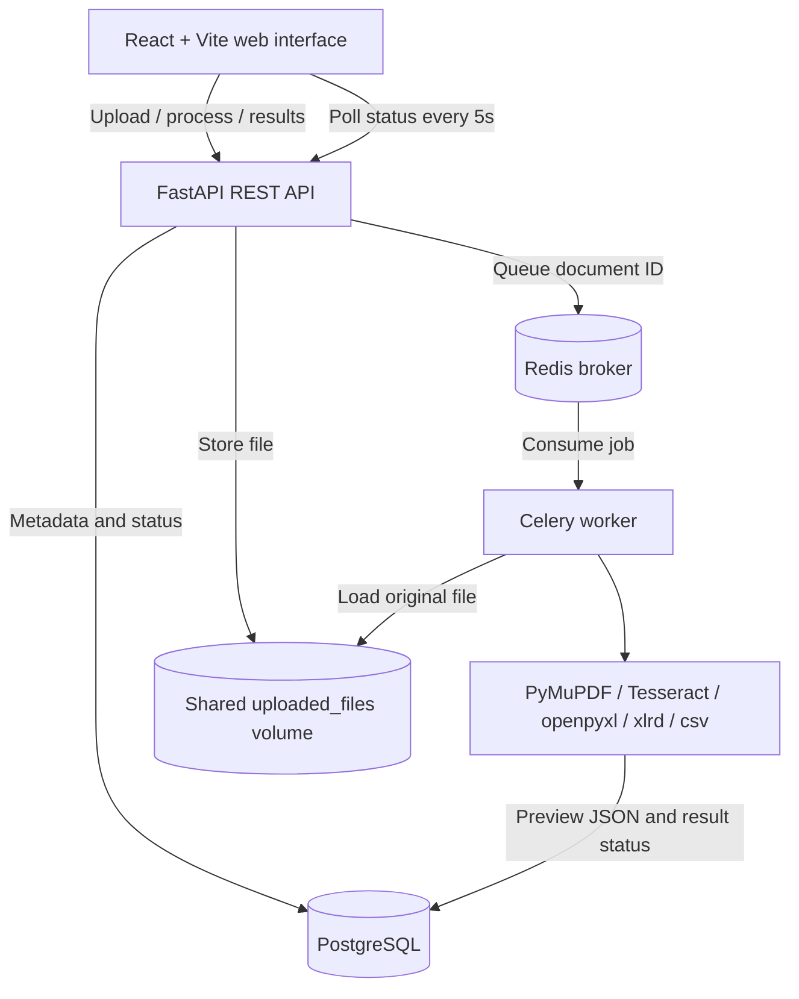

# Phase 2 architecture

`documents` (existing Phase 1): id, original_filename, stored_filename, content_type, size_bytes, sha256, status, error_message, created_at.

`document_results` (new Phase 2): document_id (foreign key to documents.id, primary key), result_json (JSON).

Changes are additive: Phase 2 creates a separate results table and preserves Phase 1 document rows.

There is no automatic job retry, user accounts, semantic search or invoice extraction yet. Worker failures update the document to `failed`; job reprocessing is manual.
