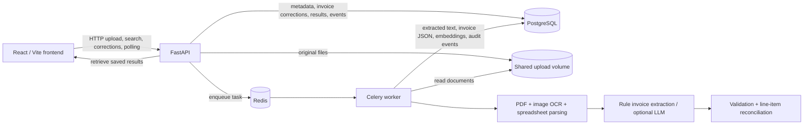
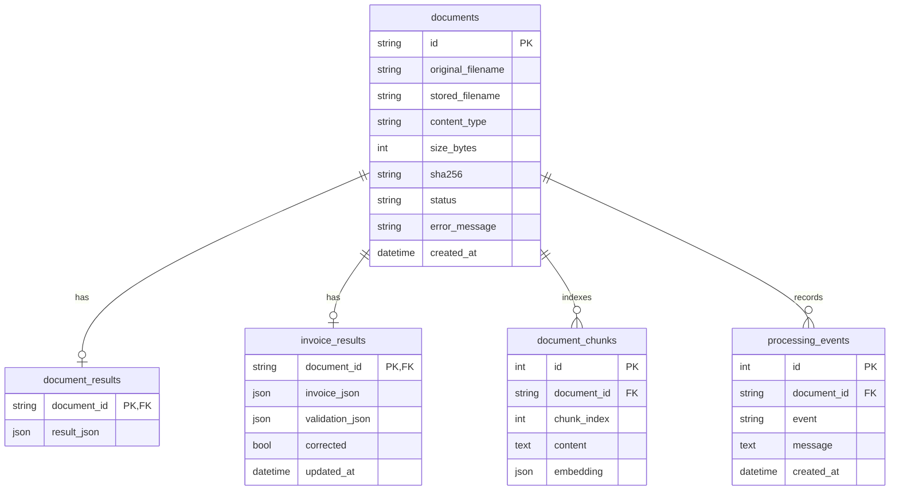

# System architecture and database schema

These diagrams describe the inspected Phase 10C source, not a production deployment.

## Request and processing architecture

`SEMANTIC_ENABLED` controls embedding generation. The worker's optional LLM call is a fallback path, not a guarantee of available third-party model access.

## Database entities

The schemas are implemented in `backend/app/models.py`. SQLAlchemy creates tables at startup, with a small additive schema adjustment; Alembic migrations are not implemented.

## Processing and data considerations

Uploads are stored under a shared Docker volume. API storage and the worker must share that volume. `queued`, `processing`, `completed`, and `failed` events appear in `processing_events`. Status polling introduces latency into end-to-end timings. File format signatures are validated for supported formats, but this is not malware scanning. The same backend stores file metadata, structured results, validation issues, text/semantic index data and corrections in PostgreSQL.
